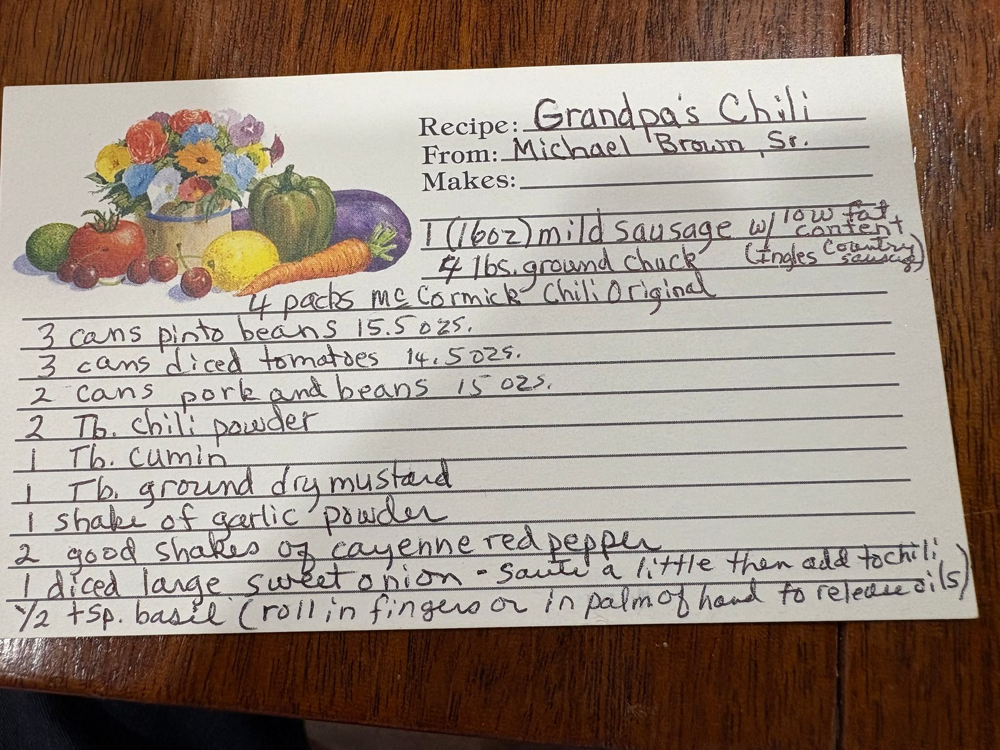
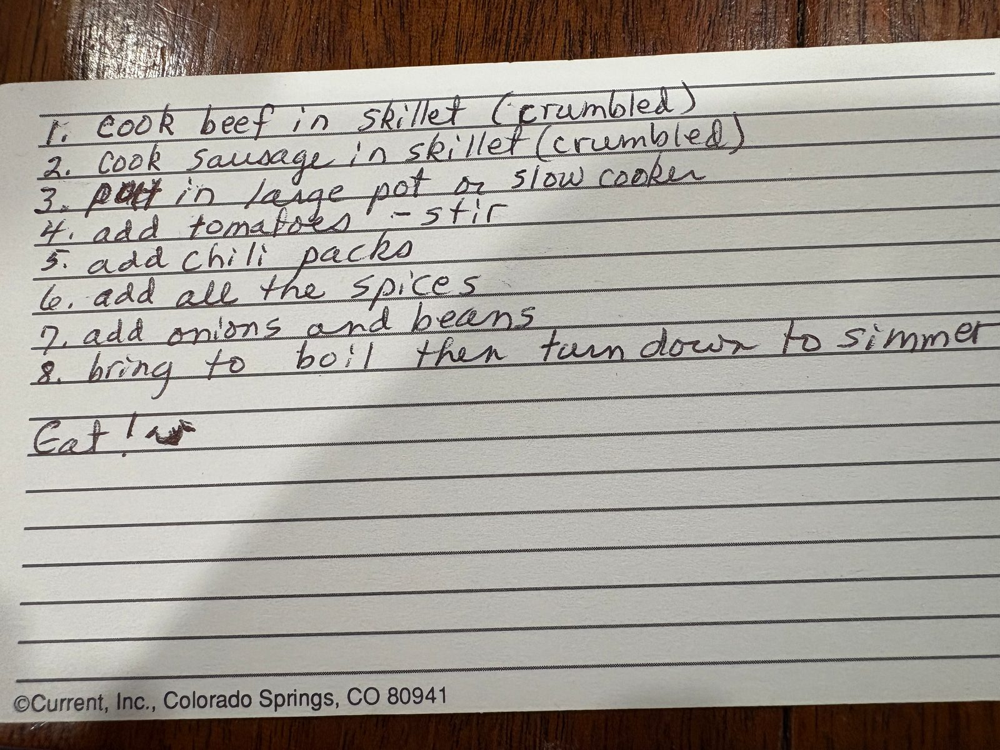

# Grandpa's Chili

A hearty big-batch chili with ground chuck, mild sausage, three kinds of canned beans and tomatoes, and McCormick chili seasoning packs. Grandpa's handwritten recipe card, simmered on the stove or in the slow cooker.

| Method | Difficulty |
|---|---|
| Large pot or slow cooker | Easy |

!!! tip "Basil trick"
    Roll the basil between your fingers or in the palm of your hand to release its oils before adding it.

## Ingredients

- **1 (16 oz)** mild sausage, low fat content
- **4 lbs** ground chuck
- **4 packs** McCormick Chili Original seasoning
- **3 cans (15.5 oz each)** pinto beans
- **3 cans (14.5 oz each)** diced tomatoes
- **2 cans (15 oz each)** pork and beans
- **2 tbsp** chili powder
- **1 tbsp** cumin
- **1 tbsp** ground dry mustard
- **1 shake** garlic powder
- **2 good shakes** cayenne red pepper
- **1 large** sweet onion, diced
- **1/2 tsp** fresh basil
- **??** cocoa powder
- **??** pickle juice

## Directions

1. Cook the ground chuck in a skillet, crumbled.
2. Cook the sausage in a skillet, crumbled.
3. Put the meat in a large pot or slow cooker.
4. Add the tomatoes and stir.
5. Add the chili seasoning packs.
6. Add all the spices.
7. Sauté the diced onion a little, then add it to the chili along with the beans.
8. Bring to a boil, then turn down to a simmer.
9. Eat!

## Brown Family Notes

- From Uncle Michael's (Michael Brown, Sr.) handwritten recipe card.
- The card names a brand of country sausage in parentheses next to the sausage. It reads like "Ingles Country Sausage."
- The card doesn't say how many it serves or how long to simmer. Simmer until thick and the flavors have come together.

## Shopping List

### Meat
- [ ] 4 lbs ground chuck
- [ ] 1 (16 oz) mild sausage, low fat

### Produce
- [ ] 1 large sweet onion

### Canned Goods
- [ ] 3 cans (15.5 oz) pinto beans
- [ ] 3 cans (14.5 oz) diced tomatoes
- [ ] 2 cans (15 oz) pork and beans

### Pantry / Spices
- [ ] 4 packs McCormick Chili Original seasoning
- [ ] Chili powder
- [ ] Cumin
- [ ] Ground dry mustard
- [ ] Garlic powder
- [ ] Cayenne red pepper
- [ ] Basil

## Photos

### Recipe Card

<figure markdown>
  { loading=lazy }
  <figcaption>Grandpa's handwritten recipe card</figcaption>
</figure>

<figure markdown>
  { loading=lazy }
  <figcaption>Grandpa's handwritten recipe card</figcaption>
</figure>

---

*Transcribed from Grandpa's handwritten recipe card for the Brown Family Kitchen.*
